# Manual do Usuário

## Gerencie seus Spools, impressões e G-code em um só lugar.

Este manual apresenta as funcionalidades disponíveis no Filament Command Center 0.1.0. Ele foi escrito para quem usa impressão 3D, mas não precisa conhecer programação ou a estrutura interna do sistema. As telas estão em Português (Brasil); quando a interface ainda mostra um rótulo em inglês, o texto é reproduzido como aparece.

> **Como usar este manual**
>
> Comece pelos capítulos 1 e 2 para conhecer o produto. Depois, siga o capítulo da tarefa que deseja realizar. Os fluxos recomendados, o glossário, as perguntas frequentes e a solução de problemas ficam no final para consulta rápida.

## Capítulo 1 — Bem-vindo ao Filament Command Center

O Filament Command Center reúne o inventário de filamentos, o acompanhamento de impressões e a análise de arquivos G-code. Com ele, você consegue saber quais filamentos possui, quanto resta em cada Spool, quais itens precisam de atenção, quais impressões estão planejadas ou em andamento e quanto material foi realmente consumido.

O produto também calcula custos de material quando o preço de compra está cadastrado, gera uma identificação por QR Code para cada Spool e analisa arquivos G-code para apresentar extrusão, peso aproximado, duração e indícios do material utilizado.

### O que é um Spool

**Spool é o carretel de filamento cadastrado no sistema.** Cada unidade física deve ser cadastrada como um Spool separado, mesmo quando duas unidades são do mesmo fabricante, material e cor.

| Conceito | Exemplo | O que representa |
|---|---|---|
| Material | PLA | O tipo de filamento e suas propriedades técnicas. |
| Fabricante | Bambu Lab | A empresa que produziu ou comercializa o filamento. |
| Cor | Preto | A aparência daquele filamento. |
| Spool | Bambu Lab Black, `FIL-0001` | A unidade física específica que está na sua prateleira. |

Essa diferença é importante: o material PLA pode aparecer em vários Spools. O peso, o preço, o estado e o histórico de uso pertencem a cada Spool individual.

### O que o produto ajuda a responder

- Quais Spools estão disponíveis, lacrados, baixos, vazios ou em uso?
- Quanto filamento ainda resta em cada unidade?
- Qual Spool será usado em uma impressão e qual é o custo previsto?
- Quanto material foi consumido quando a impressão terminou?
- O G-code possui uma estimativa de tempo ou informação de material?
- Qual é o peso aproximado do filamento descrito pelo G-code?

## Capítulo 2 — Primeiros passos

Ao abrir `/`, o Filament Command Center leva você ao **Inventário**. O **Painel** é uma visão geral separada e pode ser aberto pelo menu.

No computador, o menu fica na lateral esquerda. No celular, toque no botão de menu no canto superior esquerdo. O nome da página atual aparece no cabeçalho. No canto superior direito, **Preferência de tema** oferece `Sistema`, `Claro` e `Escuro`; a escolha fica salva no dispositivo.

### Preparar o primeiro uso

Uma instalação sem dados pode ser preparada inteiramente pelo navegador:

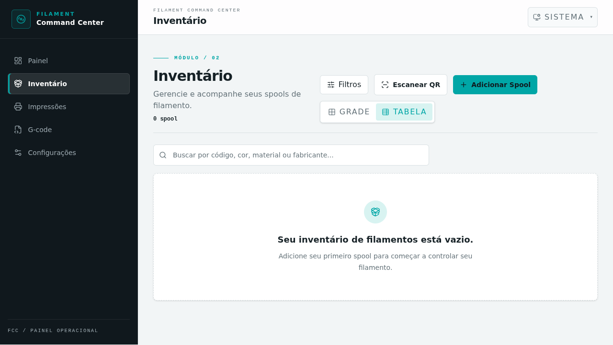

*Primeiro uso — O Inventário vazio indica a próxima ação.*

1. Abra **Configurações → Catálogos**.
2. Em **Fabricantes**, selecione **Adicionar fabricante** e informe a marca do filamento.
3. Em **Materiais**, selecione **Adicionar material** e informe ao menos nome e categoria.
4. Volte ao **Inventário**, selecione **Adicionar Spool** e use os itens que acabou de cadastrar.

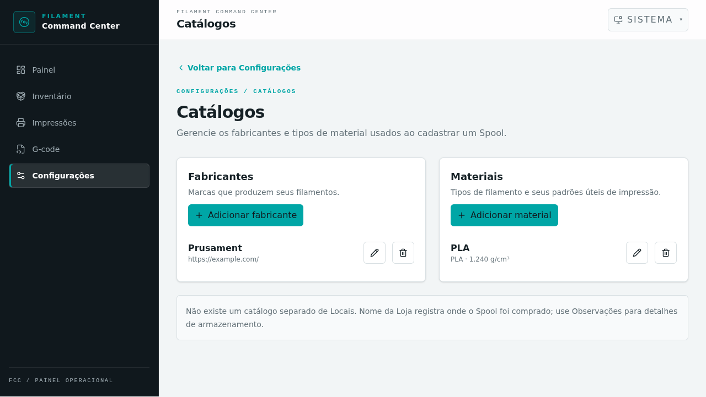

*Catálogos — Os dados cadastrados ficam disponíveis no formulário de novo Spool.*

Fabricantes representam as marcas que produzem os filamentos. Materiais representam tipos como PLA, PETG ou TPU e podem guardar densidade e temperaturas padrão. Esses cadastros são reutilizados em vários Spools; os nomes informados pelo usuário não são traduzidos quando o idioma muda.

O local de armazenamento não possui um catálogo separado. **Nome da Loja** registra a loja onde o Spool foi comprado. Para referências de armazenamento, como “Prateleira A” ou “Dry Box”, use **Observações**.

Se um fabricante ou material já estiver associado a um Spool, o produto preserva o histórico e recusa sua exclusão. Nesse caso, mantenha o item no catálogo e edite apenas quando a mudança continuar representando o mesmo dado.

> 💡 **Densidade:** esse valor é usado pela análise de G-code para estimar o peso do filamento. Se não souber o valor correto, consulte a ficha técnica do fabricante ou deixe o campo em branco.

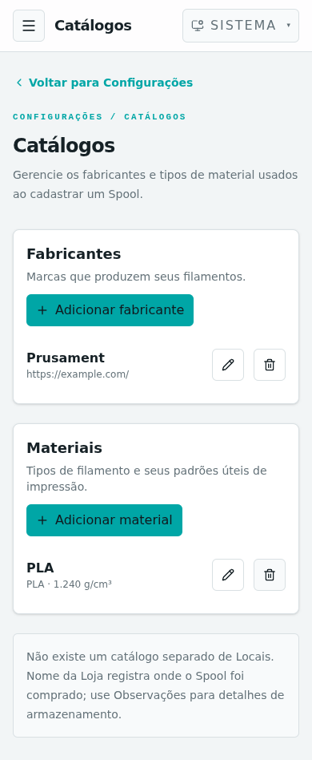

*Catálogos no celular — Fabricantes e Materiais permanecem disponíveis em cartões empilhados.*

### Mapa do produto

| Área | Para que serve | Ações principais |
|---|---|---|
| Painel | Ver totais e itens que precisam de atenção. | Conferir estoque, materiais, baixo, vazio e secagem. |
| Inventário | Consultar e organizar Spools. | Buscar, filtrar, alternar Tabela/Grade e adicionar Spool. |
| Detalhes do Spool | Consultar uma unidade física. | Ver peso, percentual, compra, QR, editar, arquivar e excluir quando permitido. |
| Impressões | Planejar e acompanhar trabalhos de impressão. | Criar, editar, iniciar, finalizar e comparar estimado com real. |
| G-code | Analisar instruções preparadas para a impressora. | Enviar arquivo, analisar, detectar material e estimar peso/tempo. |
| Configurações | Ajustar preferências e dados reutilizáveis. | Gerenciar Catálogos, alterar idioma e baixar este manual. |

Analytics não aparece no menu porque ainda não é uma funcionalidade disponível. O Painel continua mostrando os dados reais do inventário; o Inventário continua sendo a página inicial.

### Painel

O **Painel** apresenta Total de Spools, Filamento Disponível, Spools com Pouco Filamento, Spools Vazios e os que Precisam de Secagem. Abaixo, agrupa o peso por material e mostra os Spools que merecem atenção.

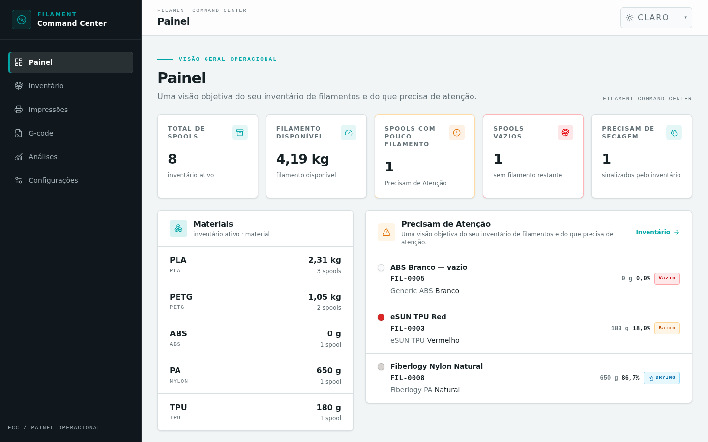

*Figura 1 — O Painel resume o inventário sem substituir a consulta detalhada de cada Spool.*

Os números consideram o inventário ativo. Um Spool arquivado não participa da visão normal. Use os alertas como ponto de partida e abra o Inventário ou os detalhes para decidir o que fazer.

> 💡 **Dica:** o Painel é útil para uma revisão rápida antes de planejar novas impressões; o Inventário é a tela adequada para localizar e comparar unidades específicas.

## Capítulo 3 — Inventário

O **Inventário** é a tela inicial e a principal lista de Spools. Cada item mostra código, nome, fabricante, material, cor, peso, percentual restante e status, conforme a visualização escolhida.

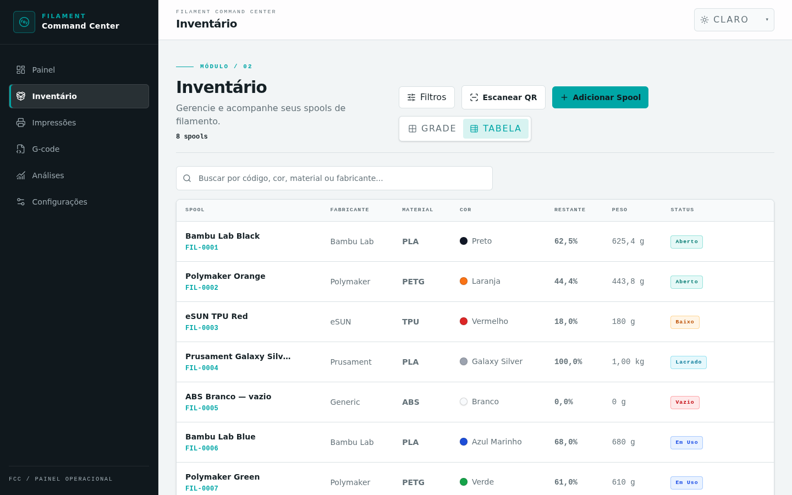

*Figura 2 — A Tabela facilita a comparação de vários Spools na mesma linha visual.*

### Tabela e Grade

Use **Tabela** quando quiser comparar rapidamente peso, percentual, fabricante e status. Use **Grade** quando preferir cartões maiores com mais destaque para nome, cor e barra de progresso. A preferência fica salva no dispositivo.

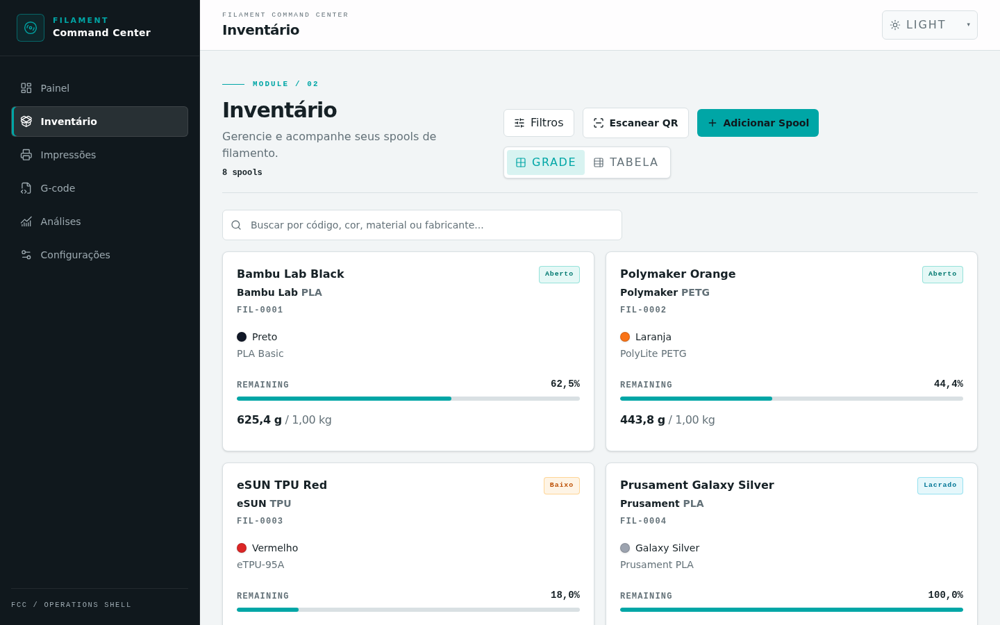

*Figura 3 — A Grade apresenta cada Spool como um cartão independente.*

Em telas menores, a Grade é a visualização inicial para evitar uma tabela larga. A preferência escolhida continua salva no dispositivo.

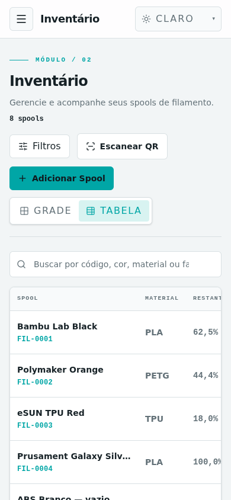

*Figura 4 — O Inventário em tela móvel conserva busca, filtros e acesso ao cadastro.*

### Busca

Digite no campo **Buscar por código, cor, material ou fabricante...**. A busca também reconhece nome do Spool e nome do produto. Exemplos úteis:

- `FIL-0002` para um código exato;
- `Orange` para nome ou cor;
- `PETG` para material;
- `Polymaker` para fabricante.

A lista é atualizada após uma pequena pausa. Use **Limpar busca** para voltar ao conjunto anterior.

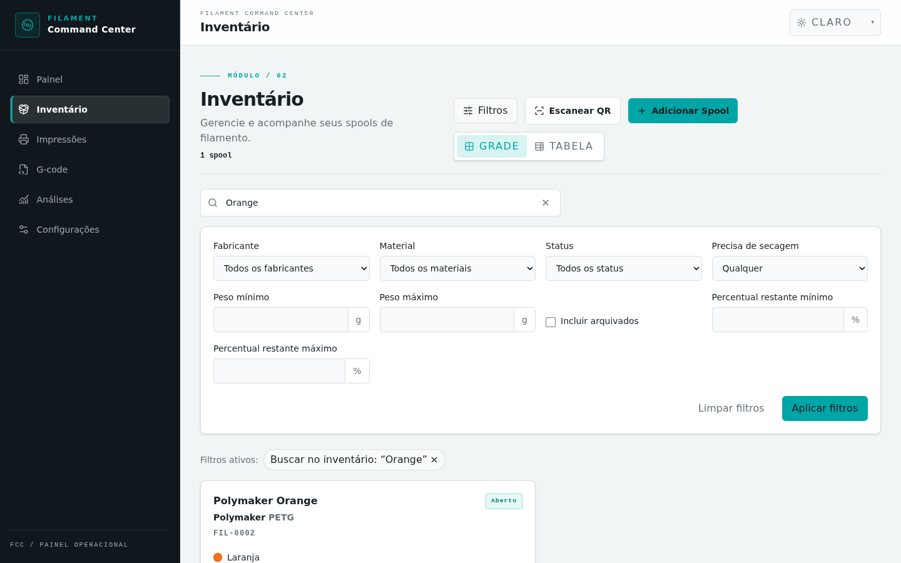

*Figura 5 — A busca pode localizar um Spool por vários dados visíveis do cadastro.*

### Filtros

Selecione **Filtros** para combinar critérios. Os filtros reais disponíveis são:

- Fabricante;
- Material;
- Status;
- Precisa de secagem;
- Peso mínimo e máximo, em gramas;
- Percentual restante mínimo e máximo;
- Incluir arquivados.

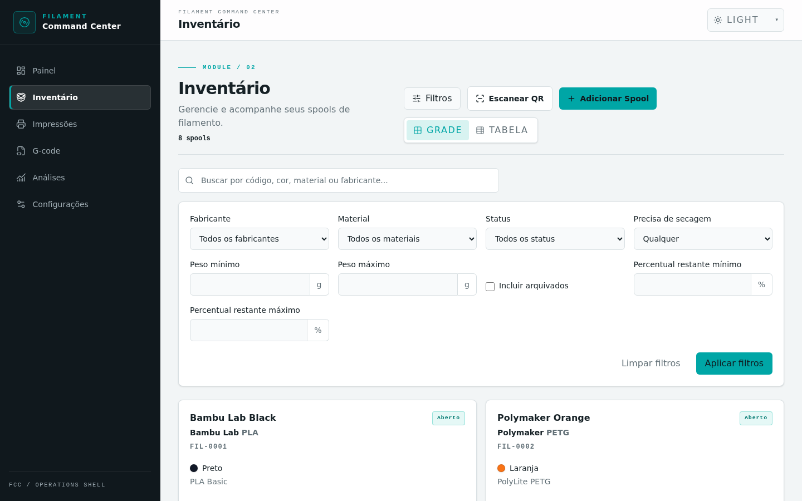

*Figura 6 — Os filtros podem ser combinados e aparecem como marcadores ativos após a aplicação.*

Selecione **Aplicar filtros**. Para remover apenas um critério, use o marcador correspondente. **Limpar filtros** remove os filtros estruturados; a busca pode ser mantida separadamente.

### Status dos Spools

| Status na interface | Significado | O que fazer |
|---|---|---|
| Lacrado (`SEALED`) | A unidade foi cadastrada como ainda fechada. | Mantenha assim enquanto não for usada. Ao iniciar uma impressão, o sistema registra a abertura. |
| Aberto (`OPEN`) | Está disponível para uso normal. | Pode ser selecionado em uma impressão. |
| Em Uso (`IN_USE`) | Está reservado por uma impressão em andamento. | Finalize a impressão atual antes de usá-lo em outra. |
| Baixo (`LOW`) | Possui até 20% ou até 200 g de filamento. | Confira se há material suficiente antes de iniciar. |
| Vazio (`EMPTY`) | O peso atual é 0 g. | Não pode iniciar uma impressão. Cadastre ou escolha outro Spool. |
| Precisa de Secagem (`NEEDS_DRYING`) | Foi sinalizado para secagem. | Seque conforme a orientação do fabricante e atualize o cadastro quando apropriado. |
| Arquivado (`ARCHIVED`) | Foi retirado do inventário ativo, mas preservado como registro. | Use **Incluir arquivados** para encontrá-lo. |

O status pode mudar automaticamente por causa do peso ou do ciclo de uma impressão. A opção **Precisa de Secagem** também é exibida como alerta, inclusive quando outro status é o principal.

## Capítulo 4 — Cadastrar um Spool

Abra **Inventário** e selecione **Adicionar Spool**.

1. Escolha o **Fabricante**.
2. Escolha o **Material**.
3. Informe **Nome da Cor**.
4. Revise o nome sugerido.
5. Confira peso, diâmetro e status inicial.
6. Preencha compra e configurações opcionais.
7. Selecione **Criar Spool**.

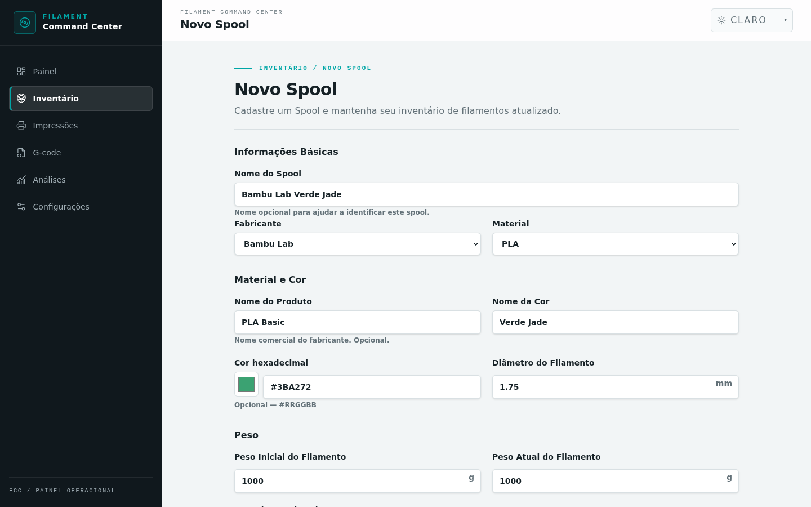

*Figura 7 — O formulário sugere “Bambu Lab Verde Jade” a partir do fabricante e da cor.*

### Campos de identificação

| Campo | Como preencher |
|---|---|
| Nome do Spool | Nome amigável e opcional. Ao escolher fabricante e cor, o sistema sugere um nome; você pode alterá-lo antes de salvar. |
| Fabricante | Empresa do filamento, escolhida no catálogo disponível. |
| Material | Tipo técnico, como PLA, PETG, TPU, ABS ou PA. |
| Nome do Produto | Linha comercial do fabricante, como “PLA Basic”. É opcional. |
| Nome da Cor | Nome legível da cor; é obrigatório. |
| Cor hexadecimal | Valor opcional no formato `#RRGGBB`, usado no indicador visual. |
| Diâmetro do Filamento | Diâmetro nominal, em milímetros. O formulário começa em `1.75`, mas o valor é editável. |

### Peso inicial, atual e do Spool vazio

**Peso Inicial do Filamento** é a quantidade de filamento que a unidade possuía no início, sem contar o plástico ou papelão do carretel. **Peso Atual do Filamento** é quanto filamento resta no momento do cadastro.

Exemplo: um produto novo de 1 kg normalmente usa 1.000 g nos dois campos. Se você está cadastrando uma unidade já usada, pode informar 1.000 g de peso inicial e 740 g de peso atual.

**Peso do Spool Vazio** é opcional e representa apenas o carretel sem filamento. Ele é uma informação separada; não some esse valor ao peso de filamento atual.

> ⚠️ **Atenção:** no uso diário, “Peso Atual do Filamento” significa filamento restante. Na finalização de uma impressão, o campo pedido é outro: **Filamento Consumido**.

### Compra, moeda e custo

Informe **Nome da Loja**, **Preço de Compra**, **Moeda** e **Data da Compra** quando quiser manter o histórico de compra. As moedas oferecidas no formulário atual são EUR, USD e GBP.

O preço e o peso inicial permitem calcular o custo estimado e o custo real do material usado em uma impressão. A moeda pertence ao cadastro daquele Spool; não é definida pelo idioma da aplicação.

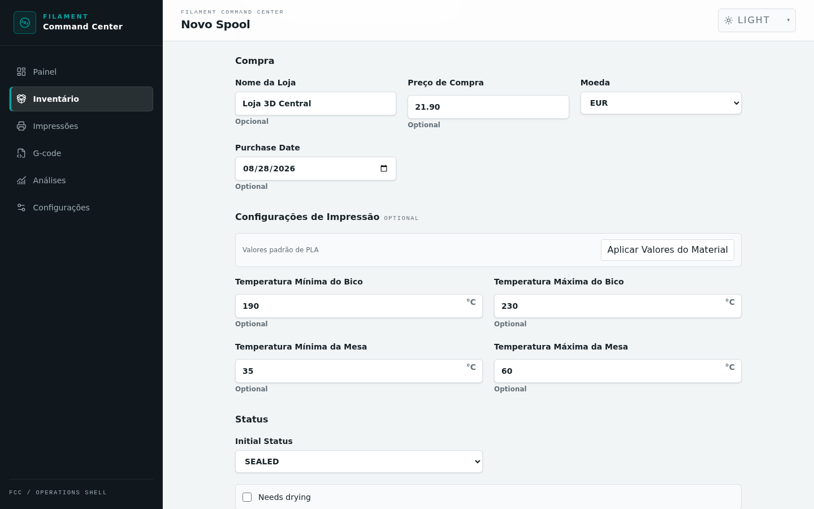

*Figura 8 — Dados de compra alimentam os cálculos de custo; temperaturas e outros detalhes são opcionais.*

### Configurações de impressão e densidade

Ao selecionar um Material, o sistema pode aplicar valores padrão de temperatura do bico e da mesa. Use **Aplicar Valores do Material** para restaurá-los. Esses valores são referências do cadastro e podem ser ajustados para a unidade.

A densidade pertence ao Material e não é digitada neste formulário. Ela é usada no cálculo de peso do G-code. Materiais diferentes podem ter densidades diferentes; por isso, escolher o Material correto melhora a estimativa.

### Status inicial e secagem

**Status inicial** permite **Lacrado** ou **Aberto**. Escolha **Lacrado** para uma unidade fechada e **Aberto** para uma unidade já aberta. Marque **Precisa de secagem** quando o filamento precisa de secagem.

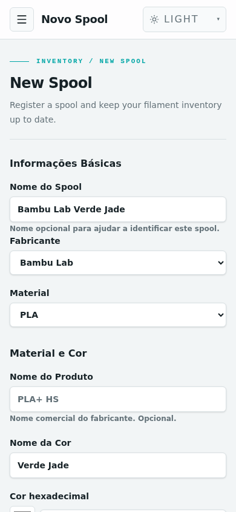

*Figura 9 — No celular, os mesmos campos são organizados em uma única coluna.*

> ✅ **Resultado:** ao salvar, o produto cria um código exclusivo no formato `FIL-XXXX` e volta ao Inventário.

## Capítulo 5 — Detalhes, peso e identificação do Spool

Abra um Spool pela Tabela, pela Grade, pela busca ou pela consulta QR. A tela de detalhes reúne informações físicas, configurações de impressão, compra, datas, observações e QR Code.

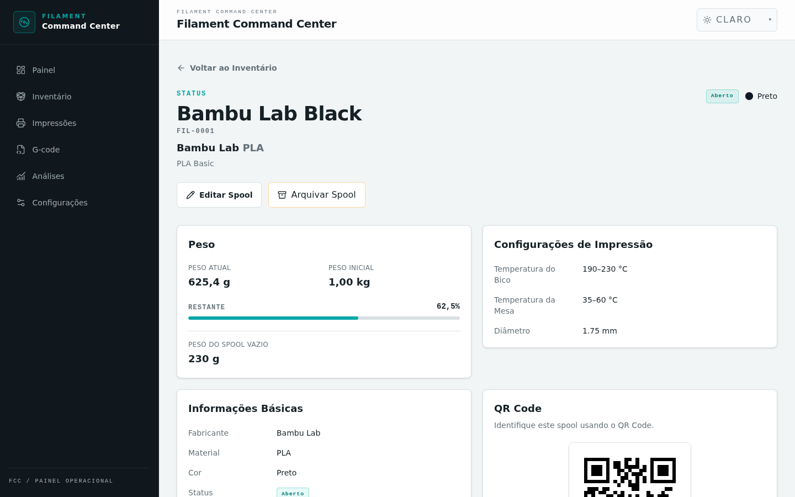

*Figura 10 — A página de detalhes mostra o peso restante e as ações disponíveis.*

### Código `FIL-XXXX`

`FIL-0001` é o identificador exclusivo do Spool. O código é criado automaticamente e não é editado junto com o nome. Alterar “Bambu Lab Black” para outro nome não altera `FIL-0001` e não invalida o QR Code.

### Percentual restante

O percentual compara o peso atual do filamento com o peso inicial. Um Spool que começou com 1.000 g e está com aproximadamente 625 g aparece com cerca de 62,5% restante. A barra é uma leitura rápida; o valor em gramas é a referência mais direta.

### Como o peso atual muda

Na interface atual, não existe um botão separado de “Atualizar peso” nem uma lista visível de histórico de pesagens. O peso atual é definido no cadastro inicial e pode ser reduzido automaticamente quando uma impressão é finalizada com consumo conhecido.

Se uma impressão consumiu 80 g de um Spool com 700 g, o sistema passa a mostrar 620 g. Se o consumo ficar em branco, o peso não muda. O capítulo 8 explica esse fluxo em detalhe.

## Capítulo 6 — Editar, arquivar e excluir

### Editar

Selecione **Editar Spool** nos detalhes. Você pode alterar nome, fabricante, Material, produto, cor, diâmetro, peso inicial, peso do Spool vazio, compra, temperaturas, sinalização de secagem e observações.

O **Peso Atual do Filamento** não é editado nessa tela. O código `FIL-XXXX` também permanece o mesmo.

### Arquivar

Selecione **Arquivar Spool** e confirme. O item sai do inventário ativo, mas pode ser encontrado com **Incluir arquivados**. Arquivar é a opção adequada quando você quer preservar o registro.

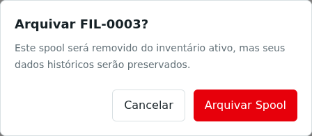

*Figura 11 — O arquivamento remove o Spool da lista ativa e preserva seu registro.*

Um Spool `IN_USE` não pode ser arquivado enquanto a impressão estiver em andamento.

### Excluir permanentemente

A exclusão permanente aparece apenas depois que o Spool foi arquivado. Ela exige a digitação do código para confirmar e não pode ser desfeita. Se o Spool tiver histórico protegido por impressões ou outros registros, a exclusão pode ser recusada; mantenha-o arquivado nesse caso.

> ⚠️ **Atenção:** use exclusão permanente apenas para um cadastro criado por engano e sem histórico útil. Para uma unidade consumida ou retirada de uso, prefira arquivar.

## Capítulo 7 — Print Tracker

Uma **impressão** é o registro de um trabalho que você pretende executar na impressora 3D. O Print Tracker organiza esses registros por estado: **Planejadas**, **Em andamento** e **Concluídas**.

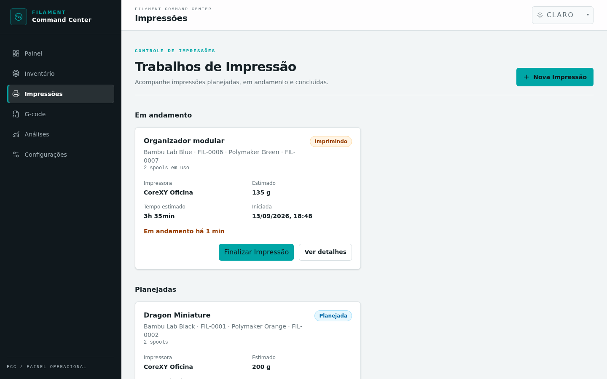

*Figura 12 — A lista separa os trabalhos conforme a etapa atual.*

### Criar uma impressão

1. Abra **Impressões**.
2. Selecione **Nova Impressão**.
3. Preencha **Nome da Impressão**.
4. Escolha o primeiro **Spool**.
5. Se souber, informe **Peso Estimado** em gramas.
6. Preencha **Horas**, **Minutos**, **Impressora** e **Observações** quando forem úteis.
7. Selecione **Criar Impressão**.

O Peso Estimado é a quantidade que você espera consumir, não o peso atual do Spool. Uma estimativa do slicer é um bom ponto de partida.

### Usar vários Spools

Selecione **Adicionar Spool** para adicionar outra unidade. Cada bloco tem seu próprio Spool e Peso Estimado. Use **Remover** para retirar um bloco. O mesmo Spool não pode aparecer duas vezes na mesma impressão.

Exemplo: uma miniatura pode usar 120 g de PLA preto no corpo e 80 g de PETG laranja nos detalhes. Isso não exige um tipo específico de alimentador; apenas registra que o trabalho usa mais de uma unidade.

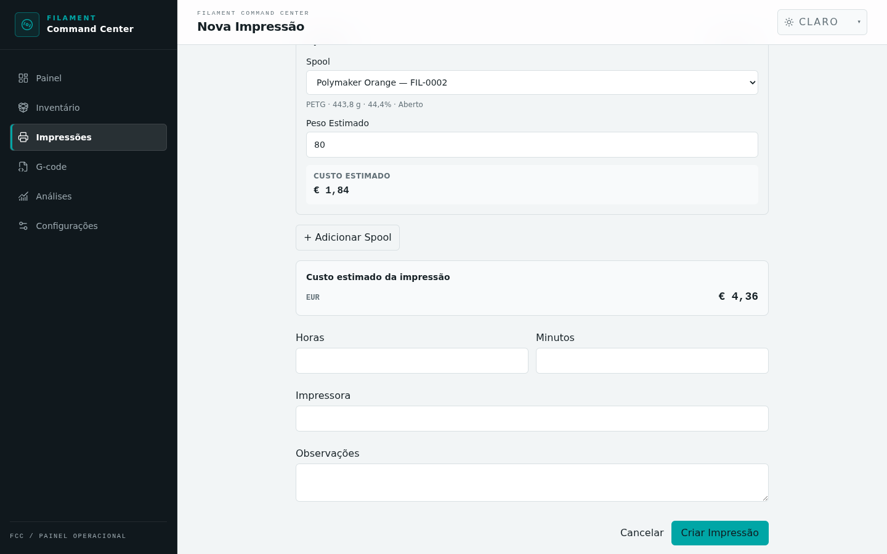

*Figura 13 — Cada Spool possui estimativa e custo próprios; o resumo mostra o total por moeda.*

No celular, os blocos continuam separados e o custo aparece abaixo de cada um.

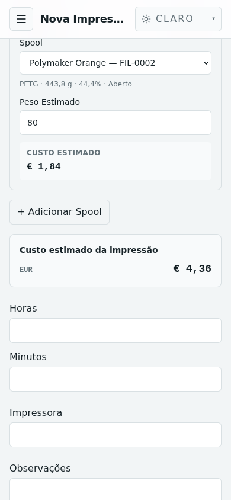

*Figura 14 — A organização vertical evita uma tabela horizontal no formulário móvel.*

### Custo estimado

Quando o Spool possui preço de compra e peso inicial, o custo aparece assim que você informa gramas válidas. No cenário da figura:

| Spool | Estimado | Custo previsto |
|---|---:|---:|
| Bambu Lab Black | 120 g | € 2,52 |
| Polymaker Orange | 80 g | € 1,84 |
| **Total EUR** | **200 g** | **€ 4,36** |

Esse valor é uma previsão. O custo real depende do consumo informado ao finalizar.

Se faltar preço, peso inicial ou gramas estimadas, a tela mostra **Custo indisponível** ou `—`. Se os Spools usam moedas diferentes, o produto mostra um subtotal para cada moeda. Valores EUR, USD e GBP não são convertidos nem somados entre si.

### Planejada e edição

Depois de criada, a impressão fica **Planejada** (`PLANNED`). Nessa fase, você ainda pode usar **Editar** para ajustar nome, Spools, estimativas, duração, impressora e observações.

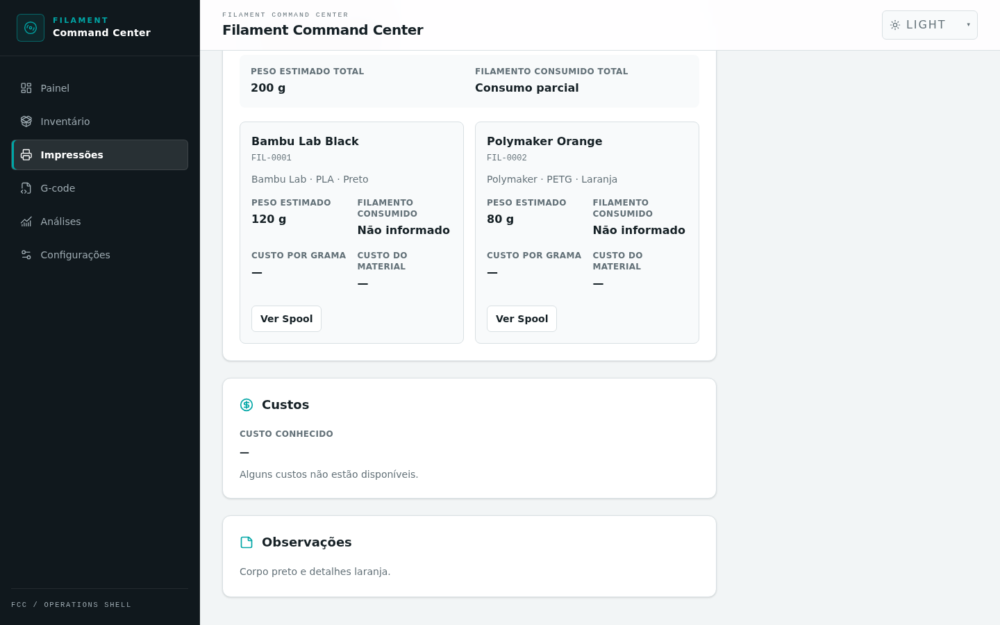

*Figura 15 — Antes do início, a impressão pode ser revisada e editada.*

### Iniciar e entender Em Uso

Selecione **Iniciar Impressão**. A confirmação mostra os Spools, o filamento disponível e a estimativa. Depois de confirmar:

1. a impressão muda de Planejada para **Imprimindo** (`PRINTING`);
2. todos os Spools relacionados ficam **Em Uso** (`IN_USE`);
3. o produto registra o horário de início;
4. a ação disponível passa a ser **Finalizar Impressão**.

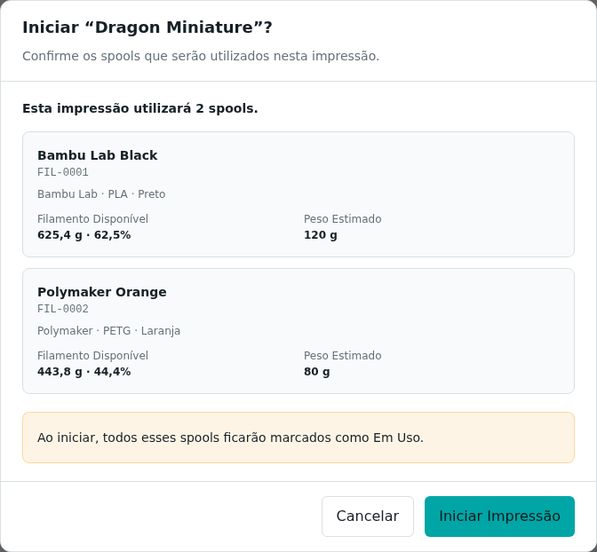

*Figura 16 — Revise códigos, pesos disponíveis e estimativas antes de iniciar.*

`IN_USE` significa que o produto reservou aquele Spool para a impressão em andamento. Isso impede que a mesma unidade seja usada ao mesmo tempo em outra impressão registrada. Spools vazios, arquivados ou já em uso não podem iniciar outro trabalho. Um Spool baixo pode ser usado, mas exige atenção à quantidade disponível.

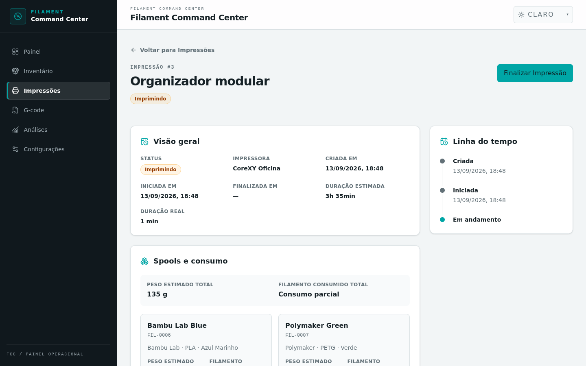

*Figura 17 — Durante a impressão, a tela mostra tempo em andamento e a ação de finalização.*

### Finalizar: informe o consumido, não o restante

Selecione **Finalizar Impressão**. Existe um campo **Filamento Consumido** para cada Spool.

```text
Spool antes da impressão: 700 g
Material consumido:        80 g  ← digite 80
Material restante:        620 g  ← não digite 620
```

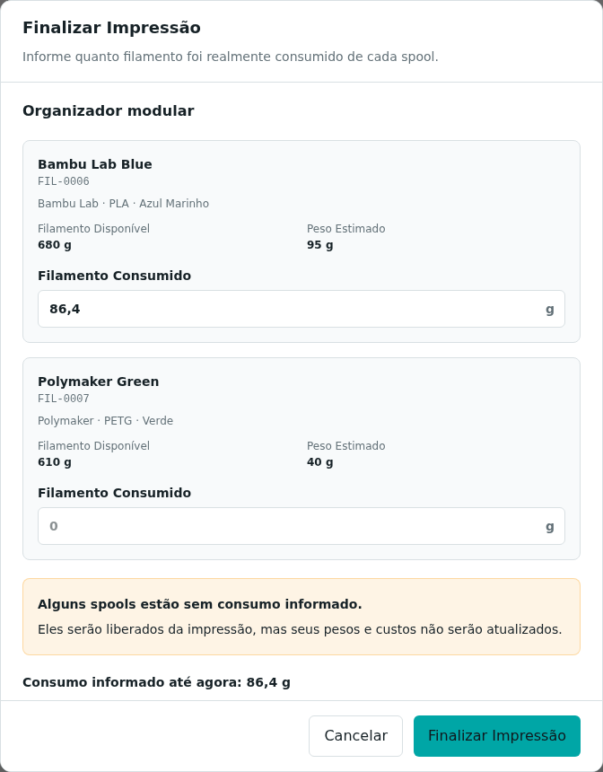

*Figura 18 — O primeiro Spool tem consumo conhecido; o segundo ficou vazio e será liberado sem alterar peso ou custo.*

> ⚠️ **Atenção:** se você digitar 620 g no exemplo, o produto entenderá que 620 g foram consumidos.

### Zero e vazio são diferentes

| Entrada | Significado | Resultado |
|---|---|---|
| `0 g` | Você sabe que não houve consumo. | Registra consumo zero e não reduz o peso. |
| Campo vazio | Você não sabe o consumo. | Não atualiza peso nem custo daquele Spool. |
| Valor positivo | O consumo é conhecido. | Reduz o peso e calcula o custo quando há preço. |

É possível finalizar com consumo conhecido para apenas alguns Spools. Todos são liberados de `IN_USE`, inclusive os que ficaram em branco.

### Depois da finalização

A impressão muda para **Concluída** (`SUCCESS`). Para cada consumo informado, o produto registra o valor, reduz o peso quando ele é positivo e calcula o custo real quando os dados de compra estão disponíveis. A estimativa original permanece para comparação.

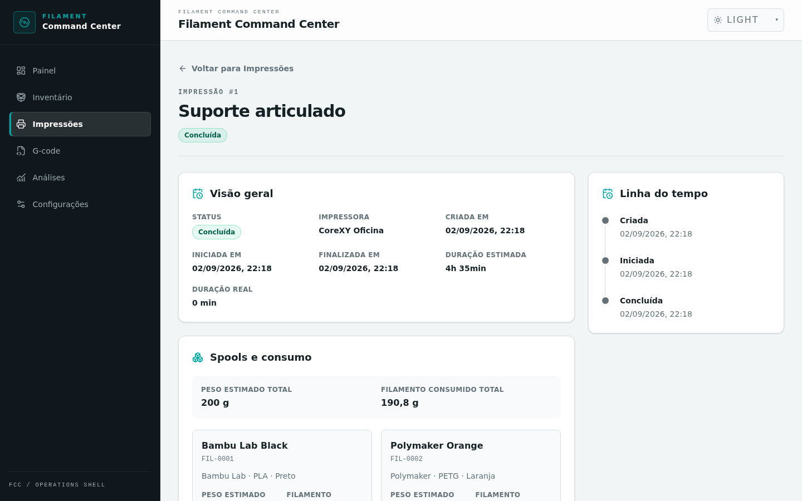

*Figura 19 — O histórico diferencia 200 g estimados de 190,8 g realmente consumidos.*

```text
Planejada → Iniciar Impressão → Imprimindo → Finalizar Impressão → Concluída
```

## Capítulo 8 — QR Code do Spool

Cada Spool possui um QR Code que identifica seu registro. Você pode colocar a etiqueta no carretel, na caixa ou na prateleira. Não é necessário conhecer o conteúdo interno do QR.

Na tela de detalhes, localize **QR Code** e selecione **Baixar QR**. O navegador baixa uma imagem SVG, adequada para redimensionar e imprimir com boa nitidez.

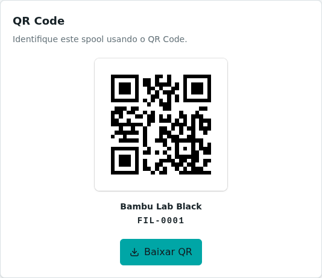

*Figura 20 — O QR é associado ao código permanente do Spool.*

Ao abrir o QR, o produto mostra uma consulta rápida com nome, status, peso atual, percentual, Material, fabricante e cor, além de um botão para os detalhes completos.

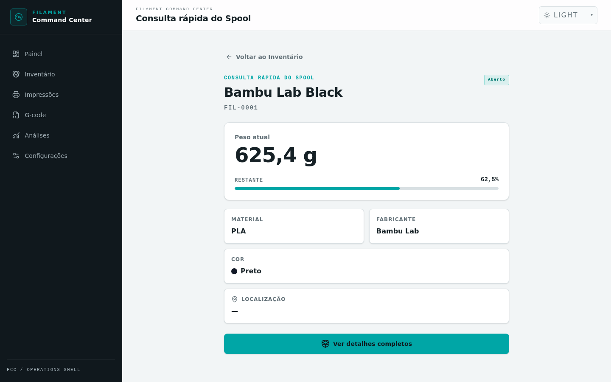

*Figura 21 — A consulta rápida foi pensada para conferência junto ao estoque físico.*

Como o QR usa o código `FIL-XXXX`, mudar o nome do Spool não o invalida.

## Capítulo 9 — Escanear QR

Abra **Escanear QR** no Inventário.

1. Selecione **Iniciar câmera**.
2. Autorize o navegador a usar a câmera.
3. Aponte para a etiqueta.
4. Quando o código for reconhecido, a consulta rápida do Spool é aberta.

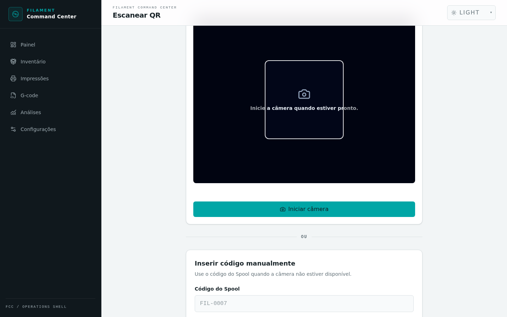

*Figura 22 — A leitura por câmera e a entrada manual ficam na mesma página.*

Alguns navegadores só liberam a câmera em uma conexão segura, normalmente HTTPS. Se a câmera não estiver disponível, use **Inserir código manualmente**, digite algo como `FIL-0007` e selecione **Abrir Spool**.

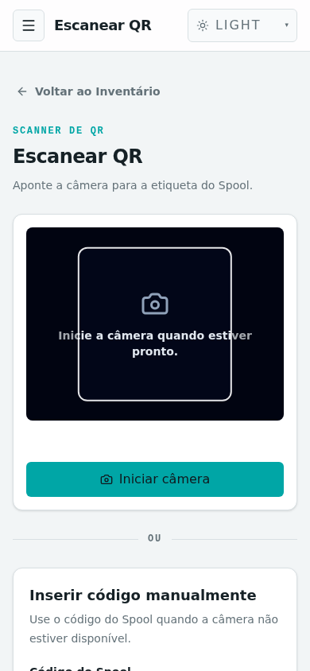

*Figura 23 — O scanner pode ser usado pelo celular, desde que o navegador permita a câmera.*

## Capítulo 10 — O que é G-code

G-code é o arquivo de instruções que a impressora usa para executar movimentos, extrusão e outras ações. Normalmente, ele é produzido por um slicer.

Uma distinção útil:

| Arquivo | O que contém |
|---|---|
| STL/3MF | O modelo e, dependendo do formato, informações do projeto. |
| G-code | As instruções já preparadas para uma combinação de perfil, material e impressora. |

O Filament Command Center analisa arquivos com extensão `.gcode`; ele não substitui o slicer nem mede fisicamente o material.

### Enviar um arquivo

1. Abra **G-code**.
2. Arraste um `.gcode` para a área ou selecione **Selecionar arquivo**.
3. Confira nome e tamanho.
4. Selecione **Enviar G-code**.
5. Depois do upload, selecione **Analisar G-code**.

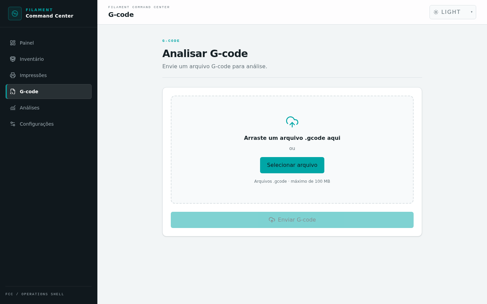

*Figura 24 — Apenas arquivos `.gcode` não vazios são aceitos.*

O limite mostrado pela instalação padrão é 100 MB. Um arquivo vazio, com outra extensão ou acima do limite é rejeitado antes do envio.

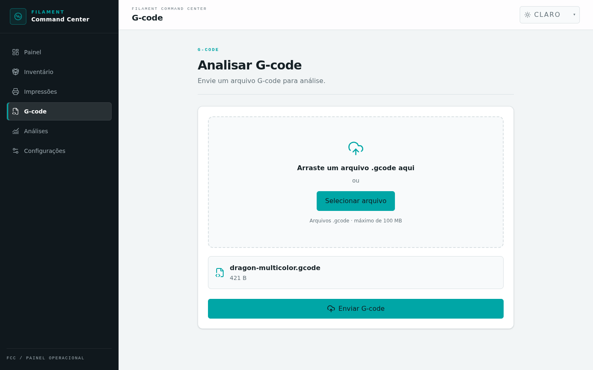

*Figura 25 — A seleção ainda não inicia a análise; primeiro envie o arquivo.*

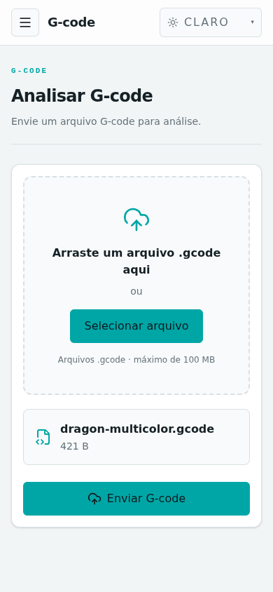

*Figura 26 — O mesmo fluxo está disponível em tela estreita.*

### Resumo da análise

O resumo pode mostrar Linhas, Comandos, Extrusores Detectados, Comprimento de Extrusão, extrusão volumétrica e detalhamento por ferramenta `T0`, `T1` e assim por diante.

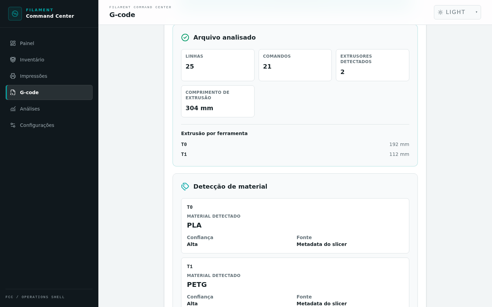

*Figura 27 — O arquivo demonstrativo possui extrusão separada para T0 e T1.*

“Ferramenta” ou “extrusor” representa a posição de extrusão usada no G-code. Um arquivo com várias ferramentas pode corresponder a várias cores ou materiais, mas isso depende de como o arquivo foi preparado.

Observações da análise indicam situações como extrusão volumétrica, modos mistos ou linhas ignoradas. Elas ajudam a interpretar o resultado; não significam automaticamente que a impressão falhará.

## Capítulo 11 — Peso estimado do G-code

O produto combina a quantidade de filamento descrita pelo arquivo com o diâmetro e a densidade do Material para estimar gramas.

1. Revise o **Material** de cada ferramenta.
2. Revise o **Diâmetro do filamento**.
3. Selecione **Calcular peso**.
4. Confira o total e o resultado por ferramenta.

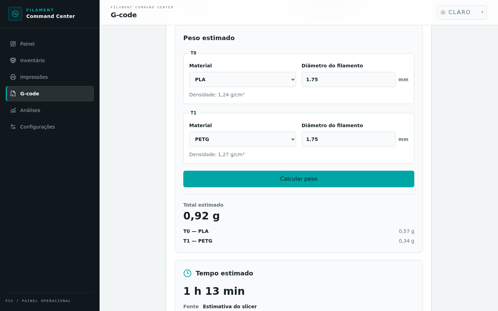

*Figura 28 — O peso total é a soma das ferramentas que puderam ser calculadas.*

O valor `1.75` é um preenchimento inicial editável quando o arquivo não fornece outro diâmetro. Nem todo filamento usa 1,75 mm; confira o produto físico ou o perfil utilizado.

**Densidade** é uma propriedade do Material usada para transformar volume em peso. Se o Material não tiver densidade ou se faltar diâmetro para uma extrusão linear, o resultado pode ficar incompleto. Nesse caso, o produto mostra o peso conhecido, mas não apresenta um total completo como se todas as ferramentas estivessem calculadas.

> ⚠️ **Atenção:** o peso do G-code é uma estimativa matemática, não uma pesagem do objeto ou do Spool. Purga, preparação da máquina e diferenças do arquivo podem afetar o consumo real.

## Capítulo 12 — Tempo estimado

O Filament Command Center apresenta uma destas fontes:

- **Estimativa do slicer:** usada quando o próprio arquivo contém uma duração reconhecida;
- **Estimativa calculada:** aproximação obtida a partir dos movimentos quando não há uma estimativa adequada do slicer.

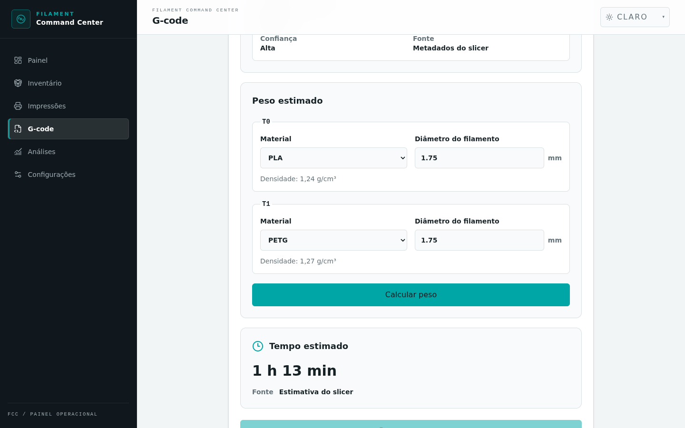

*Figura 29 — A fonte acompanha o valor para ajudar a interpretar a estimativa.*

A estimativa calculada pode não considerar completamente aquecimento, aceleração, pausas, troca de ferramenta e particularidades da impressora. A duração real pode ser diferente. Use o número para planejamento, não como garantia de horário.

## Capítulo 13 — Detecção de Material

O G-code pode conter o nome do Material nos comentários gravados pelo slicer. Quando isso acontece e o nome corresponde ao catálogo, a detecção tende a ser mais segura. Quando a informação não existe, temperaturas do bico e da mesa podem servir como pista.

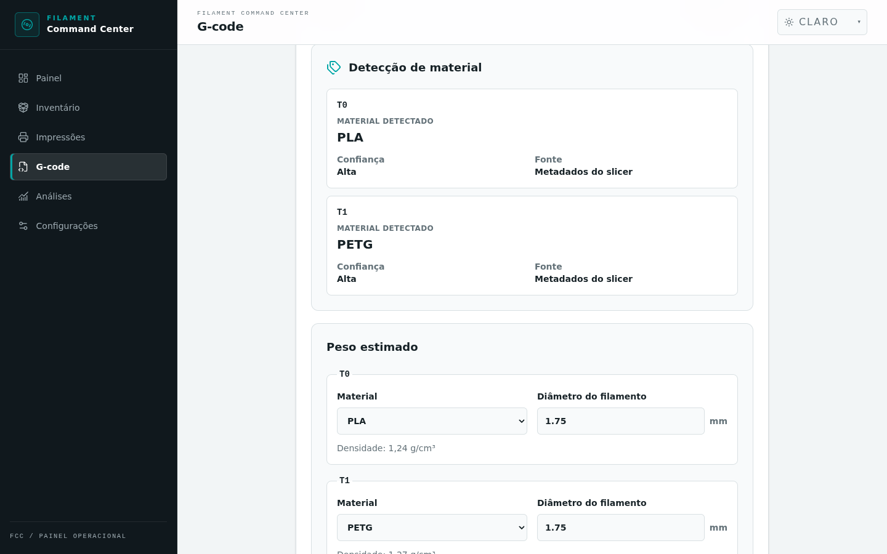

*Figura 30 — Cada ferramenta apresenta Material, confiança e fonte da detecção.*

### Como interpretar a confiança

| Confiança | Interpretação prática |
|---|---|
| Alta | Existe uma correspondência forte, normalmente informação explícita do slicer. Ainda assim, revise. |
| Média | Há um candidato provável, mas a evidência não é tão direta. |
| Baixa | Existem apenas pistas ou mais de uma opção plausível. |
| Nenhuma | O arquivo e as temperaturas não permitiram uma sugestão útil. |

Temperaturas semelhantes podem servir a vários materiais. Por isso, a detecção por temperatura é uma sugestão, não uma confirmação química.

Quando a confiança é Alta e o Material existe no catálogo, o cálculo de peso pode preencher a seleção automaticamente. Você continua podendo revisar e escolher outro Material antes de calcular.

## Capítulo 14 — Configurações

Abra **Configurações** para alterar o idioma ou baixar o manual.

### Idioma

Em **Idioma**, escolha **Português (Brasil)** ou **English**. A preferência fica salva no dispositivo e altera a interface disponível imediatamente.

### Manual do usuário

Em **Manual do usuário**, selecione **Baixar manual (PDF)**. O arquivo completo é baixado pela URL relativa `/docs/filament-command-center-user-guide.pdf`.

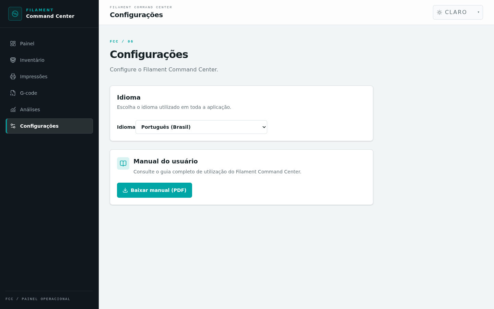

*Figura 31 — O card de manual oferece o documento completo em PDF.*

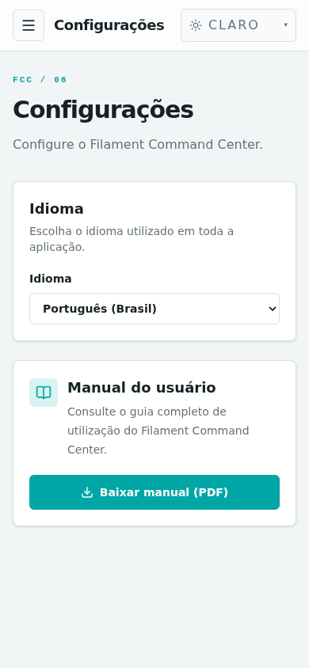

*Figura 32 — O download também está disponível no celular.*

## Capítulo 15 — Fluxos recomendados

### Fluxo A — Comprei um Spool novo

1. Abra **Inventário**.
2. Selecione **Adicionar Spool**.
3. Escolha Fabricante e Material.
4. Informe cor e revise o nome sugerido.
5. Confira peso inicial e atual.
6. Preencha preço, moeda e loja se quiser custos.
7. Escolha `SEALED` ou `OPEN` em `Initial Status`.
8. Selecione **Criar Spool**.
9. Nos detalhes, use **Baixar QR** se quiser uma etiqueta.

### Fluxo B — Vou começar uma impressão

1. Abra **Impressões** e **Nova Impressão**.
2. Dê um nome claro.
3. Selecione um ou mais Spools.
4. Informe os gramas estimados de cada um.
5. Revise os custos e avisos.
6. Salve a impressão.
7. Abra os detalhes e selecione **Iniciar Impressão**.
8. Confirme códigos e pesos disponíveis.

### Fluxo C — A impressão terminou

1. Abra a impressão em andamento.
2. Selecione **Finalizar Impressão**.
3. Digite o material **consumido** em cada Spool conhecido.
4. Deixe em branco apenas o consumo desconhecido.
5. Confirme a finalização.
6. Verifique estimado versus real e o novo peso dos Spools.

### Fluxo D — Recebi um G-code

1. Abra **G-code**.
2. Selecione o arquivo `.gcode`.
3. Envie e selecione **Analisar G-code**.
4. Revise ferramentas, extrusão e observações.
5. Confira a detecção de Material.
6. Revise Material e diâmetro no cálculo de peso.
7. Selecione **Calcular peso**.
8. Confira peso, tempo e suas respectivas limitações.

## Capítulo 16 — Glossário

**Spool** — Carretel de filamento cadastrado como uma unidade física. Cada Spool recebe um código `FIL-XXXX`.

**Filamento** — Material em forma de fio utilizado pela impressora para construir a peça.

**Material** — Tipo técnico do filamento, como PLA, PETG, ABS, TPU ou PA. Pode fornecer densidade e temperaturas padrão.

**Fabricante** — Empresa associada ao produto de filamento.

**G-code** — Arquivo de instruções preparado para a impressora, normalmente gerado por um slicer.

**Slicer** — Programa que transforma um modelo e suas configurações em instruções de impressão.

**Bico (nozzle)** — Componente aquecido por onde o filamento é extrudado.

**Mesa (bed)** — Superfície onde a peça é impressa; pode ser aquecida.

**Densidade** — Propriedade do Material utilizada para estimar peso a partir do volume de filamento.

**Diâmetro do filamento** — Espessura nominal do fio, por exemplo 1,75 mm.

**Impressão** — Registro de um trabalho planejado, em andamento ou concluído no Print Tracker.

**Consumo estimado** — Quantidade de filamento que você espera usar antes de imprimir.

**Consumo real** — Quantidade que você informa como efetivamente consumida ao finalizar.

**`IN_USE` / Em Uso** — Estado temporário que reserva um Spool para uma impressão em andamento.

**QR Code** — Código visual que abre a consulta do Spool associado.

**Ferramenta / Extrusor (`T0`, `T1`)** — Posição de extrusão identificada no G-code; cada uma pode usar um Material diferente.

## Capítulo 17 — Perguntas frequentes

### Por que meu Spool está Em Uso?

Uma impressão em andamento o reservou. Abra **Impressões**, localize o trabalho e finalize-o para liberar todos os Spools associados.

### Por que não consigo iniciar com um Spool?

Spools vazios, arquivados ou já em uso são bloqueados no início. Um Spool arquivado também deixa de aparecer na seleção normal de novas impressões.

### Posso usar dois Spools na mesma impressão?

Sim. Use **Adicionar Spool** e informe uma estimativa separada para cada unidade. O mesmo Spool não pode ser repetido no mesmo trabalho.

### O que coloco em Peso Estimado?

A quantidade de filamento que você espera consumir, em gramas. Não coloque o peso total disponível nem o peso do carretel.

### Ao finalizar, coloco peso restante ou consumido?

Consumido. Se havia 700 g e foram usados 80 g, digite `80`, não `620`.

### O que acontece se eu não souber o consumo?

Deixe o campo daquele Spool vazio. A impressão pode ser finalizada, o Spool é liberado, mas peso e custo não são atualizados por esse trabalho.

### Posso registrar consumo zero?

Sim. `0 g` significa consumo conhecido igual a zero; campo vazio significa consumo desconhecido.

### Por que o custo não aparece?

Confira se o Spool tem Preço de Compra e Peso Inicial e se você informou gramas estimadas ou reais. Sem esses dados, o custo fica indisponível.

### Posso cadastrar um Spool sem preço?

Sim. O preço é opcional; apenas os cálculos de custo ficam indisponíveis.

### O que acontece com moedas diferentes?

O produto mantém subtotais separados por moeda. Ele não converte nem soma EUR com USD ou GBP.

### Por que o G-code não possui peso estimado?

Pode faltar densidade do Material, diâmetro do filamento ou dados calculáveis para uma ferramenta. Revise cada bloco e tente novamente.

### Por que o tempo é apenas aproximado?

O tempo pode vir do slicer ou de uma aproximação dos movimentos. Aquecimento, aceleração, pausas e comportamento da máquina podem alterar a duração real.

### Por que o sistema não detectou o Material?

O arquivo pode não informar o Material e suas temperaturas podem servir a várias opções. Selecione manualmente o Material correto no cálculo de peso.

### Posso escanear o QR pelo celular?

Sim, se o navegador permitir acesso à câmera. Em alguns casos é necessária conexão HTTPS. O código manual é a alternativa.

### O que é `FIL-0007`?

É o identificador exclusivo de um Spool. Ele é gerado pelo sistema e continua o mesmo quando o nome é alterado.

### Posso mudar o nome do Spool?

Sim. Abra os detalhes, selecione **Editar Spool** e altere **Nome do Spool**.

### O QR deixa de funcionar se eu mudar o nome?

Não. Ele identifica o código `FIL-XXXX`, que não muda junto com o nome.

## Capítulo 18 — Solução de problemas

| Problema | Possível causa | O que fazer |
|---|---|---|
| Spool não aparece em uma nova impressão | Está arquivado. | Use **Incluir arquivados** para confirmar o estado; um arquivado não pode ser usado para iniciar. |
| A impressão não inicia | Um Spool está Em Uso, Vazio ou Arquivado. | Abra os detalhes dos Spools e corrija o estado ou finalize a impressão que os reservou. |
| Custo estimado não aparece | Faltam preço, peso inicial ou gramas estimadas. | Complete os dados do Spool e informe uma estimativa positiva. |
| Consumo é recusado | Valor maior que o filamento disponível ou formato inválido. | Informe um número igual ou maior que zero e não superior ao peso atual. |
| QR Scanner não abre câmera | Permissão negada, câmera ausente ou conexão não segura. | Autorize a câmera, tente HTTPS ou digite `FIL-XXXX` manualmente. |
| QR abre Spool não encontrado | O registro foi excluído ou o código não existe. | Confira a etiqueta e pesquise o código no Inventário. |
| G-code é rejeitado | Extensão incorreta, arquivo vazio ou acima do limite. | Use um `.gcode` válido, não vazio e dentro do limite mostrado. |
| Análise não mostra extrusão | O arquivo não contém extrusão reconhecível. | Confirme se é o arquivo final gerado pelo slicer para impressão. |
| Peso estimado está incompleto | Falta Material/densidade, diâmetro ou dados de uma ferramenta. | Revise todos os blocos T0, T1 etc. e calcule novamente. |
| Material tem confiança Baixa | A evidência é ambígua. | Trate como sugestão e escolha o Material correto manualmente. |
| Tempo calculado parece diferente da impressora | A estimativa não modela todos os eventos da máquina. | Use como referência e compare com a estimativa do slicer ou da impressora. |
| Spool não pode ser arquivado | Está Em Uso. | Finalize a impressão em andamento antes de arquivar. |
| Spool arquivado não pode ser excluído | Possui histórico protegido. | Mantenha-o arquivado para preservar os registros. |

### Antes de pedir ajuda

1. Confirme a página e o código do Spool ou número da impressão.
2. Leia a mensagem exibida pela interface.
3. Revise pesos: restante no cadastro, consumido na finalização.
4. Verifique se o Spool está Em Uso, Vazio ou Arquivado.
5. No G-code, confira extensão, tamanho, Material e diâmetro.

## Capítulo 19 — Boas práticas para uso diário

- Dê nomes que ajudem a reconhecer a unidade física, mas sempre confira o código `FIL-XXXX`.
- Cadastre preço e moeda para obter custos úteis.
- Use o QR na caixa ou prateleira para reduzir trocas de Spool por engano.
- Planeje cada Spool com gramas separados em trabalhos multi-material.
- Finalize a impressão logo após o término e informe consumo conhecido.
- Nunca use zero para representar “não sei”; deixe vazio.
- Compare estimado com real para melhorar planejamentos futuros.
- Revise a detecção de Material e o diâmetro antes de confiar no peso de G-code.
- Arquive em vez de excluir quando houver histórico relevante.

## Capítulo 20 — Limites importantes

O Filament Command Center organiza informações fornecidas pelo usuário e extraídas do G-code. Ele não pesa fisicamente um Spool, não confirma a composição química do filamento e não garante o tempo real da máquina.

Na versão atual da interface:

- o Peso Atual é definido no cadastro e reduzido por consumo real informado;
- não há uma tela separada de pesagem nem histórico de peso visível;
- fabricante e Material são escolhidos nos catálogos existentes, sem tela de gestão no fluxo do usuário;
- a análise de G-code não cria automaticamente uma impressão no Print Tracker;
- estimativas devem ser revisadas antes de decisões de produção.

Esses limites ajudam a interpretar corretamente o que é registro, o que é estimativa e o que precisa ser confirmado na impressora ou no estoque físico.

## Referências

Nenhuma fonte externa foi necessária. As explicações deste manual foram baseadas no comportamento da aplicação, nos textos exibidos na interface e nas regras funcionais verificadas no produto.
