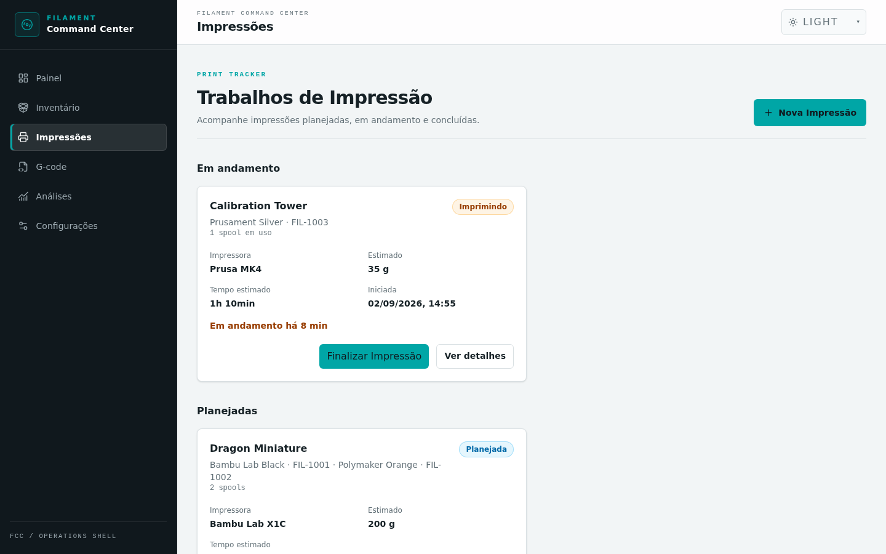
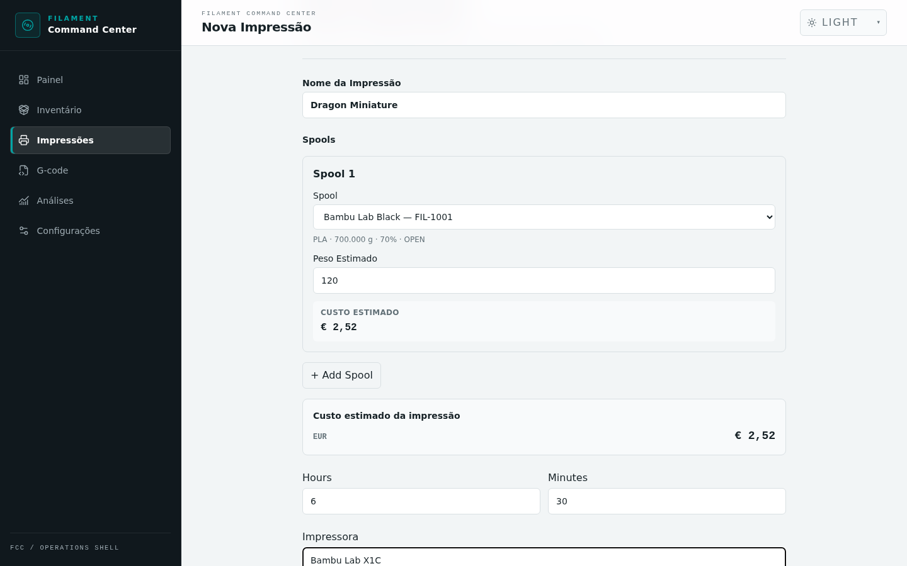
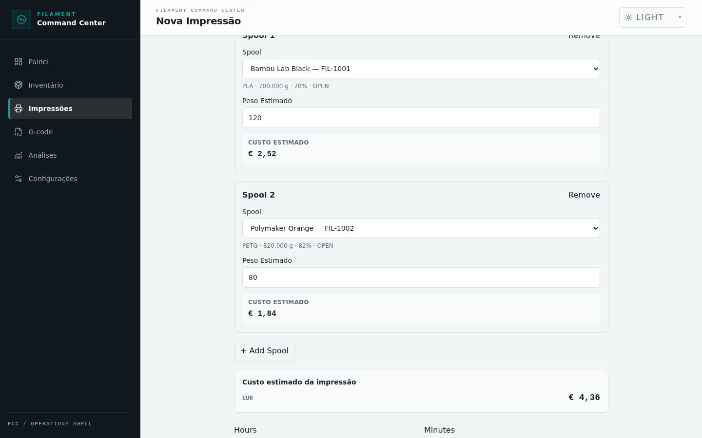
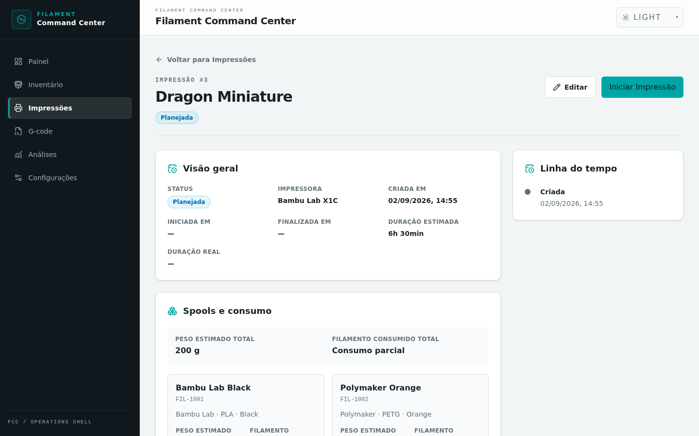
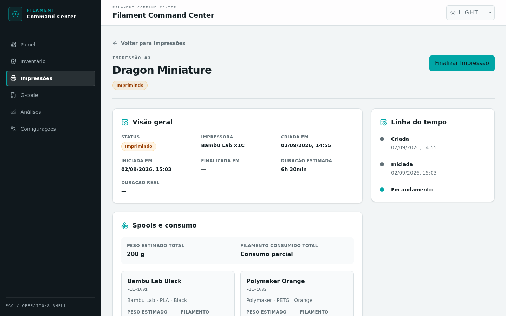
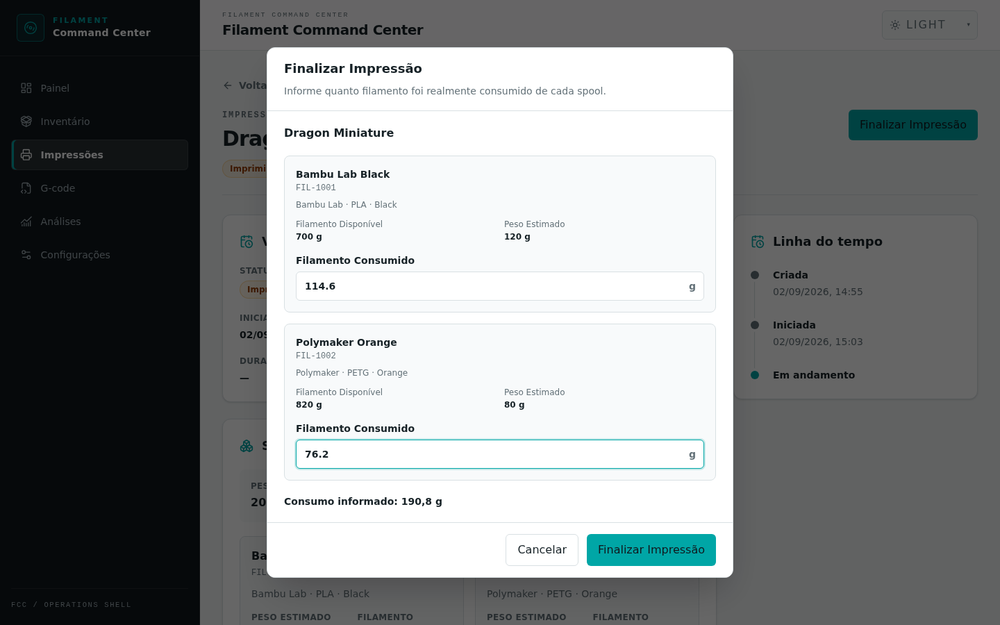
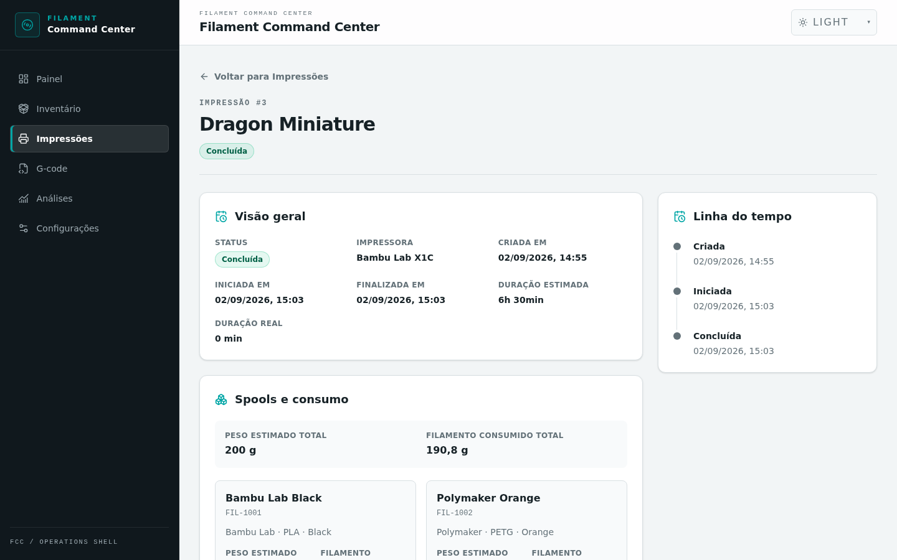
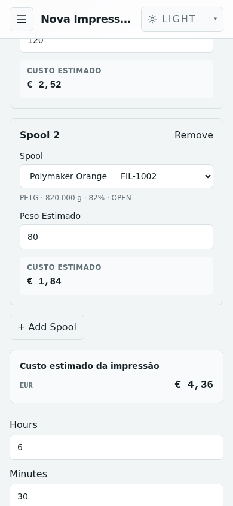

# Print Tracker

## Do planejamento ao término de uma impressão

O Print Tracker reúne, em um só lugar, o planejamento, o acompanhamento e o consumo de filamento das suas impressões. Cada Print pode usar um ou vários Spools, com uma estimativa separada para cada material.

> **O que você aprenderá**
>
> - criar uma Print e selecionar seus Spools;
> - estimar material e custo antes de imprimir;
> - iniciar a impressão e entender o estado `IN_USE`;
> - finalizar com o consumo real de cada Spool.



*O Print Tracker organiza as impressões por estado e mantém o histórico acessível.*

---

## 1. Criar uma Print

1. Abra **Impressões** no menu lateral.
2. Selecione **Nova Impressão**.
3. Informe um nome fácil de reconhecer.
4. Escolha o primeiro **Spool**.
5. Preencha o **Peso Estimado** em gramas, se você já souber quanto material será necessário.
6. Opcionalmente, informe duração estimada, impressora e observações.
7. Selecione **Criar Impressão**.



*Planejamento da Dragon Miniature com o primeiro Spool selecionado.*

| Campo | Para que serve |
|---|---|
| Nome da Impressão | Identifica a Print nas listas e no histórico. |
| Spool | Define qual filamento será usado. |
| Peso Estimado | Registra a previsão de uso daquele Spool, em gramas. |
| Duração | Guarda a previsão de tempo da impressão. |
| Impressora | Indica a máquina planejada. |
| Observações | Guarda detalhes úteis, como perfil ou acabamento. |

> 💡 **Dica:** use a estimativa de filamento fornecida pelo slicer como ponto de partida para o Peso Estimado.

## 2. Planejar uma impressão com vários Spools

Uma Print pode usar quantos Spools forem necessários. Cada bloco representa um Spool e possui seu próprio Peso Estimado.

1. Preencha o primeiro Spool.
2. Selecione **+ Add Spool**.
3. Escolha o próximo Spool e informe o peso correspondente.
4. Repita enquanto precisar de mais materiais.
5. Use **Remove** para retirar um Spool que não fará mais parte da Print.



*Uma Print multi-Spool com 120 g de PLA e 80 g de PETG.*

No exemplo:

| Uso | Spool | Material | Estimado |
|---|---|---|---:|
| T0 / Spool 1 | Bambu Lab Black | PLA | 120 g |
| T1 / Spool 2 | Polymaker Orange | PETG | 80 g |

Antes de salvar, confira se cada posição aponta para o Spool físico correto. O mesmo Spool não pode ser adicionado duas vezes à mesma Print.

## 3. Entender o custo estimado

Quando o Spool possui dados de compra e você informa um Peso Estimado, o formulário mostra o **Custo estimado** imediatamente. O resumo **Custo estimado da impressão** reage às alterações de peso, à troca de Spool e à inclusão ou remoção de materiais.

No cenário acima, a interface calculou:

```text
Bambu Lab Black   120 g   € 2,52
Polymaker Orange   80 g   € 1,84
                             ──────
Custo estimado da impressão  € 4,36
```

Esse valor é uma previsão para o planejamento. O custo real é registrado ao finalizar a impressão, quando o consumo real é informado.

> ⚠️ **Atenção:** se faltarem dados de preço do Spool, o custo aparece como **Custo indisponível**, não como zero.

Se os Spools usam moedas diferentes, o Print Tracker apresenta um subtotal para cada moeda. Valores em EUR, USD ou outras currencies **não são somados nem convertidos entre si**.

## 4. Revisar uma Print planejada

Depois de criada, a Print fica no estado `PLANNED`, exibido na interface como **Planejada**. Isso significa que ela foi cadastrada, mas ainda não começou.

Na tela de detalhes você pode:

- conferir Spools, pesos e duração estimada;
- revisar impressora e observações;
- selecionar **Editar** para ajustar uma Print planejada;
- selecionar **Iniciar Impressão** quando estiver pronto.



*A tela de detalhes antes do início da impressão.*

## 5. Iniciar a impressão

Ao selecionar **Iniciar Impressão**, o sistema apresenta uma confirmação com todos os Spools relacionados. Revise os itens antes de continuar.

Quando o início é confirmado:

1. a Print muda de `PLANNED` para `PRINTING`;
2. os Spools associados passam para `IN_USE`;
3. a tela começa a mostrar o tempo em andamento;
4. a ação disponível passa a ser **Finalizar Impressão**.



*A Print em andamento, com linha do tempo e ação de finalização.*

> **Por que meu Spool ficou `IN_USE`?**
>
> O Spool fica reservado para a Print em andamento. Isso evita que o mesmo filamento seja usado simultaneamente em outra impressão. Depois de finalizar a Print, ele é liberado e volta ao status normal do inventário, conforme o peso e as demais condições registradas.

Spools vazios, arquivados ou já em uso não podem iniciar outra impressão. Um Spool com pouco filamento pode ser usado, mas a confirmação apresenta um aviso para você revisar a quantidade disponível.

## 6. Finalizar e informar o consumo real

Selecione **Finalizar Impressão** para abrir o formulário de consumo. Existe um campo **Filamento Consumido** para cada Spool.



*Consumo real informado separadamente para Bambu Lab Black e Polymaker Orange.*

### Informe o que foi consumido, não o que restou

Suponha que o Spool tinha **700 g** antes da impressão e usou **80 g**:

```text
Filamento disponível antes: 700 g
Filamento consumido:          80 g  ← informe este valor
Filamento restante:          620 g  ← não informe este valor
```

> ⚠️ **Atenção:** preencher `620 g` nesse exemplo seria interpretado como 620 g consumidos.

### Zero e campo vazio têm significados diferentes

| Entrada | Significado | O que acontece |
|---|---|---|
| `0 g` | Você sabe que não houve consumo. | O consumo zero é registrado; o peso não é reduzido. |
| Campo vazio | Você não sabe o consumo. | Peso e custo daquele Spool não são atualizados. |
| Valor positivo | Consumo conhecido. | O valor é descontado e registrado no histórico. |

### É possível finalizar parcialmente

Você pode informar o consumo de apenas alguns Spools. A própria janela avisa quando existem campos vazios.

Mesmo sem consumo informado, **todos os Spools deixam de ficar reservados** ao finalizar a Print. Os Spools omitidos mantêm o peso anterior e ficam sem custo real para essa impressão.

## 7. O que acontece depois de finalizar

Depois da confirmação, a Print muda para `SUCCESS`, exibido como **Concluída**. Para cada consumo informado, o Print Tracker registra o valor e calcula o custo real quando os dados de compra do Spool estão disponíveis. Consumos positivos também atualizam o peso e o histórico do Spool.

Todos os Spools associados são liberados, inclusive aqueles cujo campo de consumo ficou vazio.



*A Print concluída com consumo total e linha do tempo atualizados.*

> ✅ **Resultado:** os Spools liberados podem ser selecionados e usados novamente em uma nova Print.

### Fluxo de estados

```text
PLANNED
   ↓  Iniciar Impressão
PRINTING
   ↓  Finalizar Impressão
SUCCESS
```

| Estado | Na interface | Significado |
|---|---|---|
| `PLANNED` | Planejada | Cadastrada e ainda não iniciada. |
| `PRINTING` | Imprimindo | Em andamento; os Spools estão reservados. |
| `SUCCESS` | Concluída | Finalizada; os Spools foram liberados. |

## Exemplo completo: Dragon Miniature

| Posição | Spool | Material | Estimado | Consumido |
|---|---|---|---:|---:|
| T0 / Spool 1 | Bambu Lab Black | PLA | 120 g | 114,6 g |
| T1 / Spool 2 | Polymaker Orange | PETG | 80 g | 76,2 g |
| **Total** |  |  | **200 g** | **190,8 g** |

O planejamento preserva a estimativa; a finalização registra o que realmente aconteceu. Assim, você pode comparar os valores sem substituir o histórico original.

## Uso em telas menores

No celular, cada Spool continua em seu próprio bloco. Peso, custo individual e resumo permanecem legíveis sem uma tabela horizontal.



*Planejamento multi-Spool em uma viewport de 390 × 844.*

## Dicas

- Use a estimativa do slicer para preencher os gramas de cada Spool.
- Confira o código e o nome do Spool antes de iniciar.
- Informe o consumo real quando ele for conhecido; isso mantém peso, histórico e custo mais úteis.
- Deixe o campo vazio quando não souber o consumo — não use zero para representar “desconhecido”.
- Revise avisos de pouco filamento antes de confirmar o início.

## Problemas comuns

### O Spool não aparece para seleção

Spools arquivados não são oferecidos para uma nova Print. Confirme também se o inventário terminou de carregar e se o Spool ainda existe.

Um Spool `IN_USE` pode estar visível, mas não poderá iniciar outra Print enquanto estiver reservado. Finalize a impressão em andamento antes de reutilizá-lo. Spools vazios também não podem iniciar uma Print.

### O custo estimado não aparece

Verifique se:

- um Spool foi selecionado;
- o Peso Estimado foi informado;
- o Spool possui preço de compra e peso inicial cadastrados.

Quando esses dados não estão disponíveis, o formulário mostra **Custo indisponível** ou um traço (`—`).

### Não sei o consumo exato

Deixe o campo daquele Spool vazio. A Print pode ser finalizada mesmo assim. O Spool será liberado, mas seu peso e seu custo real não serão atualizados por essa impressão.

### Finalizei a impressão. Posso usar o Spool novamente?

Sim. Ao finalizar, todos os Spools da Print são liberados. Eles voltam a poder ser usados, desde que o status normal do inventário permita — por exemplo, um Spool vazio continuará indisponível.

